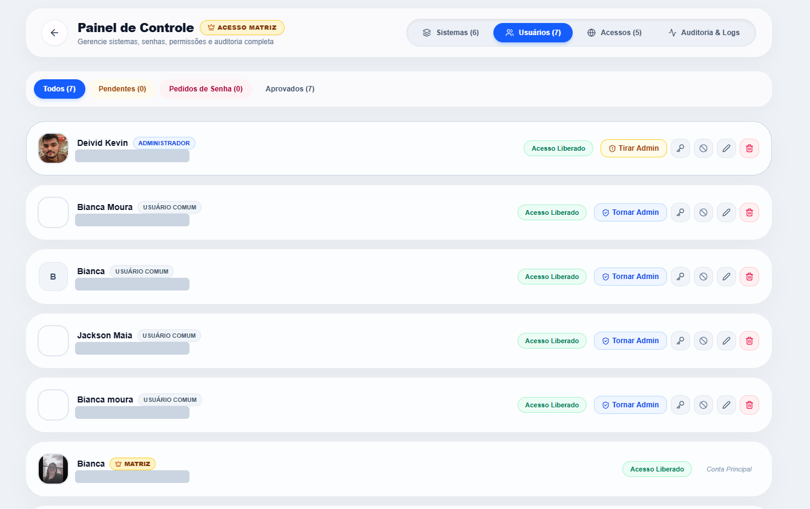
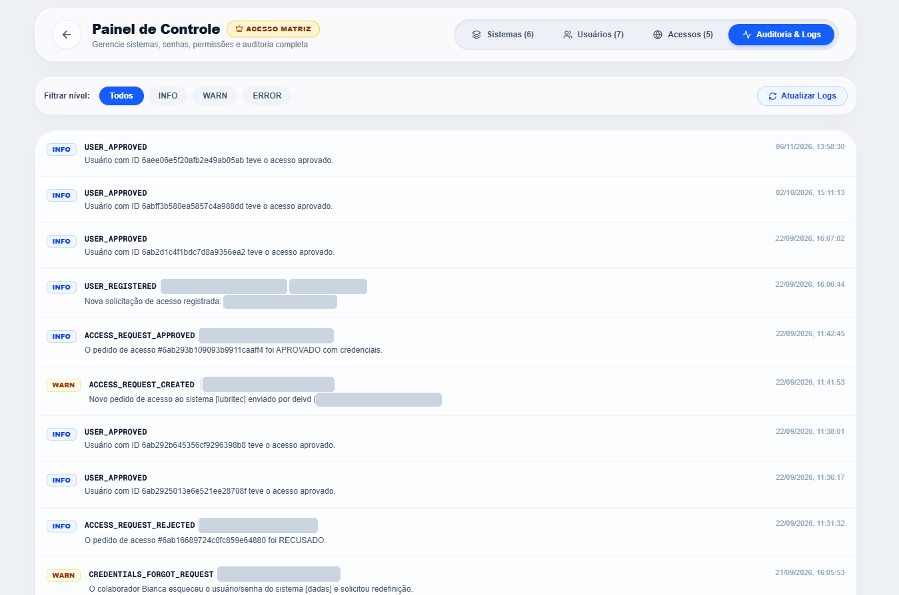

<div align="center">

# HUB

**Tudo o que você precisa, em um só lugar.**

Portal corporativo que centraliza o acesso aos sistemas e ferramentas da empresa em um carrossel interativo, com favoritos, atalhos pessoais e perfis de acesso. Disponível na web e como aplicativo desktop.

[](https://nextjs.org)
[](https://react.dev)
[](https://www.typescriptlang.org)
[](https://tailwindcss.com)
[](https://www.mongodb.com)
[](https://www.electronjs.org)

[Acessar demo](https://hub-biancamx.vercel.app) · [Reportar bug](https://github.com/biancamx/Hub/issues) · [Sugerir melhoria](https://github.com/biancamx/Hub/issues)

</div>

---

## Sobre o projeto

Em empresas com várias plataformas internas (gestão de demandas, treinamentos, diagnósticos, sites de acesso), cada colaborador acaba guardando dezenas de links diferentes. O **Hub** resolve isso: uma única tela de entrada, autenticada, onde cada pessoa encontra os sistemas aos quais tem acesso e abre qualquer um com um clique.

A interface é construída em torno de um **carrossel de cartões**: o sistema em foco aparece em destaque e os demais ficam esmaecidos nas laterais, com navegação por setas e indicadores de posição.

## Funcionalidades

- **Carrossel de sistemas:** cada cartão mostra logo, nome, descrição curta, categoria e o botão **Acessar Ferramenta**, que abre o sistema em nova aba.
- **Favoritos:** marque sistemas com a estrela; os favoritos ficam acessíveis por um atalho rápido logo abaixo do carrossel.
- **Meu Atalho (pessoal):** o usuário adiciona um link particular ao próprio carrossel por meio do cartão **Adicionar Meu Sistema**. Esses atalhos são identificados como *Pessoal*.
- **Grupos de acesso:** agrupamentos como **Acessos Sites** reúnem links relacionados, com contador de itens.
- **Perfil de acesso:** o cabeçalho exibe o usuário logado com um selo do seu perfil/unidade (ex.: **Matriz**).
- **Notificações:** ícone de sino no cabeçalho para avisos ao usuário.
- **Tutorial do Hub:** botão de ajuda sempre visível para orientar novos usuários.
- **Painel de Controle (Matriz):** gestão de sistemas, usuários, acessos e logs em um só lugar.
- **Fluxo de aprovação:** novos cadastros e pedidos de acesso a sistemas passam por aprovação de um administrador.
- **Gestão de senhas e permissões:** redefinição de credenciais, bloqueio de contas e promoção/remoção de administradores.
- **Auditoria completa:** logs com níveis INFO/WARN/ERROR registram quem fez o quê e quando.
- **Autenticação segura:** login com Auth.js (NextAuth v5) e senhas protegidas com hash via `bcryptjs`.
- **Web e desktop:** o mesmo código roda no navegador (Vercel) e como app instalável para Windows (Electron).
- **Interface moderna:** transições fluidas com Framer Motion, visual limpo com Tailwind CSS 4.

## Telas

### Painel do usuário
Carrossel com os sistemas liberados, favoritos, atalho pessoal e grupos de acesso.


### Painel de Controle (acesso Matriz)
Área administrativa com quatro abas: **Sistemas**, **Usuários**, **Acessos** e **Auditoria & Logs**.

**Sistemas:** cadastro, edição e remoção de sistemas, com busca por título ou URL, status (Online) e gestão dos atalhos do painel "Acessos Sites".


**Usuários:** aprovação de cadastros, pedidos de senha pendentes, promoção ou remoção de administradores, redefinição de credenciais, bloqueio, edição e exclusão de contas.



**Auditoria & Logs:** registro de eventos do sistema (cadastros, aprovações e recusas de acesso, pedidos de redefinição de credenciais), com filtro por nível (INFO, WARN, ERROR), data/hora e atualização sob demanda.



> Dados pessoais (e-mails e IPs) foram ocultados nas capturas de tela.

## Stack

| Camada | Tecnologias |
| --- | --- |
| Framework | Next.js 16 (App Router), React 19 |
| Linguagem | TypeScript 5 |
| Estilo | Tailwind CSS 4, PostCSS |
| Animações e ícones | Framer Motion, Lucide React, React Icons |
| Autenticação | Auth.js (`next-auth` v5 beta), `bcryptjs` |
| Banco de dados | MongoDB, Mongoose, `@auth/mongodb-adapter` |
| Desktop | Electron 44, electron-builder |
| Qualidade | ESLint 9, `eslint-config-next` |
| Deploy | Vercel (web) e electron-builder (desktop) |

## Estrutura do projeto

```
Hub/
├── electron/            # Processo principal do Electron (entrada: electron/main.js)
├── public/              # Arquivos estáticos (logos, imagens, ícones)
├── src/                 # Código-fonte da aplicação Next.js
├── docs/                # Screenshots e documentação
├── eslint.config.mjs    # Configuração do ESLint
├── next.config.ts       # Configuração do Next.js
├── postcss.config.mjs   # Configuração do PostCSS / Tailwind
├── tsconfig.json        # Configuração do TypeScript
└── package.json         # Dependências e scripts
```

## Como rodar localmente

### Pré-requisitos

- [Node.js](https://nodejs.org) 20 ou superior
- npm (ou yarn, pnpm, bun)
- Uma instância do MongoDB (local ou [MongoDB Atlas](https://www.mongodb.com/atlas))

### Passo a passo

```bash
# 1. Clone o repositório
git clone https://github.com/biancamx/Hub.git
cd Hub

# 2. Instale as dependências
npm install

# 3. Configure as variáveis de ambiente (veja abaixo)

# 4. Inicie o servidor de desenvolvimento
npm run dev
```

Acesse [http://localhost:3000](http://localhost:3000).

### Variáveis de ambiente

Crie um arquivo `.env.local` na raiz:

```env
# Conexão com o MongoDB
MONGODB_URI="mongodb+srv://<usuario>:<senha>@<cluster>.mongodb.net/hub"

# Segredo usado pelo Auth.js (gere com: npx auth secret)
AUTH_SECRET="troque-por-um-valor-seguro"
```

> Os nomes acima são os padrões esperados para essa stack. Se o projeto usar outros, ajuste esta seção. Nunca faça commit do `.env.local`.

## Versão desktop (Electron)

Com o servidor Next.js em execução, abra o app desktop em outro terminal:

```bash
npm run desktop
```

Para gerar o instalador do Windows:

```bash
npm run build
npm run dist:win
```

## Scripts disponíveis

| Comando | Descrição |
| --- | --- |
| `npm run dev` | Servidor de desenvolvimento |
| `npm run build` | Build de produção |
| `npm run start` | Executa o build de produção |
| `npm run lint` | Roda o ESLint |
| `npm run desktop` | Abre a aplicação no Electron |
| `npm run dist:win` | Empacota o app desktop para Windows |

## Deploy

A versão web é publicada na [Vercel](https://vercel.com):

1. Importe o repositório na Vercel.
2. Cadastre as variáveis de ambiente em **Settings → Environment Variables**.
3. Cada push na `main` gera uma nova versão automaticamente.

## Roadmap

- [x] Carrossel de sistemas com favoritos
- [x] Atalhos pessoais por usuário
- [x] Autenticação e perfis de acesso
- [x] Aplicativo desktop para Windows
- [ ] Instaladores para macOS e Linux
- [ ] Testes automatizados
- [ ] CI/CD com GitHub Actions

## Contribuindo

1. Faça um fork do projeto
2. Crie uma branch: `git checkout -b feat/minha-feature`
3. Commit suas mudanças: `git commit -m "feat: minha feature"`
4. Push: `git push origin feat/minha-feature`
5. Abra um Pull Request

## Licença

Projeto proprietário. Todos os direitos reservados. <!-- Se for open source, adicione um arquivo LICENSE (ex.: MIT) e ajuste aqui. -->

---

<div align="center">

Desenvolvido por **[Bianca](https://github.com/biancamx)**

</div>
